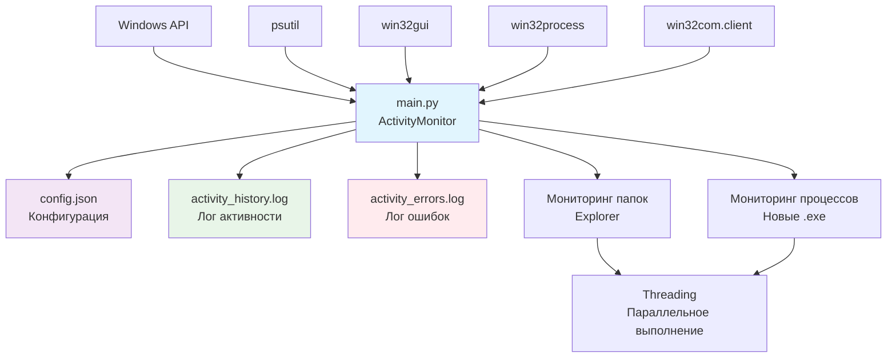
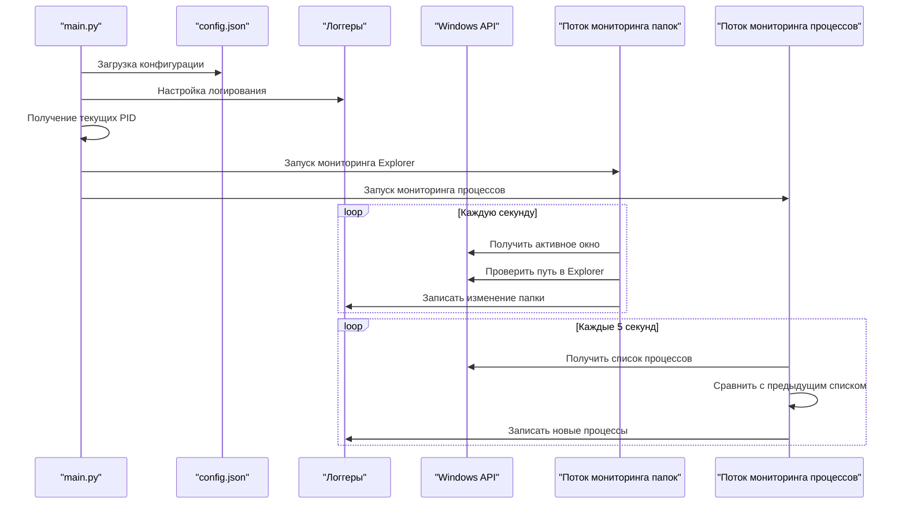

# 📊 Activity Monitor - Система мониторинга активности пользователя

> **Скрытый мониторинг файловой навигации и запуска программ в Windows**

## 📁 1. Структура проекта

```
1/
├── config.json          # Конфигурационные параметры
├── main.py              # Основной модуль с классом ActivityMonitor
├── requirements.txt     # Зависимости Python
└── README.md           # Документация проекта
```

**Генерируемые файлы при работе:**
- `activity_history.log` - Основной лог активности
- `activity_errors.log` - Лог ошибок и исключений

## 📄 2. Описание файлов

### 🐍 `main.py` (91 строка)
**Назначение:** Основной модуль, содержащий класс `ActivityMonitor` для отслеживания пользовательской активности.

**Ключевые компоненты:**
- **Класс `ActivityMonitor`** - Главный класс системы мониторинга
- **Методы конфигурации:**
  - `_load_config()` - Загрузка настроек из JSON
  - `_setup_logging()` - Настройка системы логирования
  - `_create_logger()` - Создание специализированных логгеров
- **Методы мониторинга:**
  - `_monitor_explorer_path()` - Отслеживание навигации по папкам
  - `_monitor_new_processes()` - Детекция новых запущенных процессов
  - `_get_current_pids()` - Получение списка активных процессов

**Связи с другими файлами:**
- Читает конфигурацию из `config.json`
- Создает логи в файлах, указанных в конфигурации
- Использует библиотеки из `requirements.txt`

**Логика работы:**
1. Инициализация с загрузкой конфигурации
2. Настройка двух независимых логгеров
3. Запуск двух параллельных потоков мониторинга
4. Непрерывная работа до прерывания пользователем

### ⚙️ `config.json` (6 строк)
**Назначение:** Конфигурационный файл с параметрами работы системы.

**Ключевые параметры:**
```json
{
  "log_file": "activity_history.log",           // Основной лог
  "error_log": "activity_errors.log",           // Лог ошибок
  "directory_check_interval_sec": 1,            // Интервал проверки папок (сек)
  "process_check_interval_sec": 5               // Интервал проверки процессов (сек)
}
```

**Связи:** Используется исключительно классом `ActivityMonitor` при инициализации.

### 📦 `requirements.txt` (2 строки)
**Назначение:** Список Python-зависимостей для работы системы.

**Библиотеки:**
- `psutil` - Кроссплатформенная библиотека для работы с процессами и системой
- `pywin32` - Python-обертки для Windows API

## 🏗️ 3. Архитектура проекта

### Общая структура



### Поток данных



## 📚 4. Библиотеки и фреймворки

| Библиотека | Назначение | Где используется |
|------------|------------|------------------|
| **psutil** | Работа с процессами и системной информацией | Получение списка процессов, информации о PID |
| **pywin32** | Доступ к Windows API | `win32gui`, `win32process`, `win32com.client` |
| **threading** | Многопоточность | Параллельный запуск мониторинга папок и процессов |
| **logging** | Система логирования | Запись активности и ошибок в файлы |
| **json** | Работа с JSON | Чтение конфигурационного файла |
| **datetime** | Работа с датой/временем | Форматирование временных меток в логах |

### Детальное использование Windows API:
- **win32gui.GetForegroundWindow()** - Получение дескриптора активного окна
- **win32process.GetWindowThreadProcessId()** - Получение PID процесса по окну
- **win32com.client.Dispatch("Shell.Application")** - Доступ к оболочке Windows для работы с Explorer

## 🚀 5. Точка входа и запуск

### Запуск проекта:
```bash
# Установка зависимостей
pip install -r requirements.txt

# Запуск мониторинга
python main.py
```

### Последовательность выполнения:
1. **Инициализация** (`__main__`):
   ```python
   monitor = ActivityMonitor()  # Создание экземпляра
   monitor.start()              # Запуск мониторинга
   ```

2. **Загрузка конфигурации** из `config.json`
3. **Настройка логирования** (создание двух логгеров)
4. **Получение начального списка процессов**
5. **Запуск двух daemon-потоков:**
   - Мониторинг папок Explorer (каждую секунду)
   - Мониторинг новых процессов (каждые 5 секунд)
6. **Бесконечный цикл** с возможностью прерывания через Ctrl+C

## 🔧 6. Архитектурные особенности

### Нестандартные решения:

1. **Двухпоточная архитектура**
   - Отдельные потоки для разных типов мониторинга
   - Использование `daemon=True` для автоматического завершения при выходе
   - `threading.Event()` для корректной остановки потоков

2. **Устойчивость к ошибкам**
   - Обработка `psutil.NoSuchProcess` и `psutil.AccessDenied`
   - Логирование ошибок в отдельный файл
   - Продолжение работы при временных сбоях

3. **Специализированное логирование**
   - Два независимых логгера для разных типов событий
   - Кастомное форматирование временных меток
   - UTF-8 кодировка для корректной записи русских символов

### Причины выбора архитектуры:

- **Производительность**: Разделение мониторинга на потоки предотвращает блокировки
- **Конфигурируемость**: JSON-конфигурация позволяет легко изменять интервалы
- **Надежность**: Обработка исключений гарантирует непрерывную работу
- **Скрытность**: Отсутствие GUI и использование daemon-потоков делает работу незаметной

## 📊 7. Функциональные возможности

### Типы отслеживаемых событий:

#### 📂 Навигация по файлам:
- Отслеживание изменения текущей папки в Windows Explorer
- Запись полных путей к посещаемым директориям
- Фиксация времени входа в каждую папку

#### 💻 Запуск программ:
- Детекция новых процессов (.exe файлов)
- Запись имени процесса и его PID
- Временные метки запуска приложений

### Формат логов:
```
2024-01-15 14:30:25 - Entered directory: C:\Users\User\Documents
2024-01-15 14:30:30 - New process: notepad.exe (PID: 1234)

---

Автор: legenda  
Telegram: [@LEGENDA_SD](https://t.me/LEGENDA_SD)
